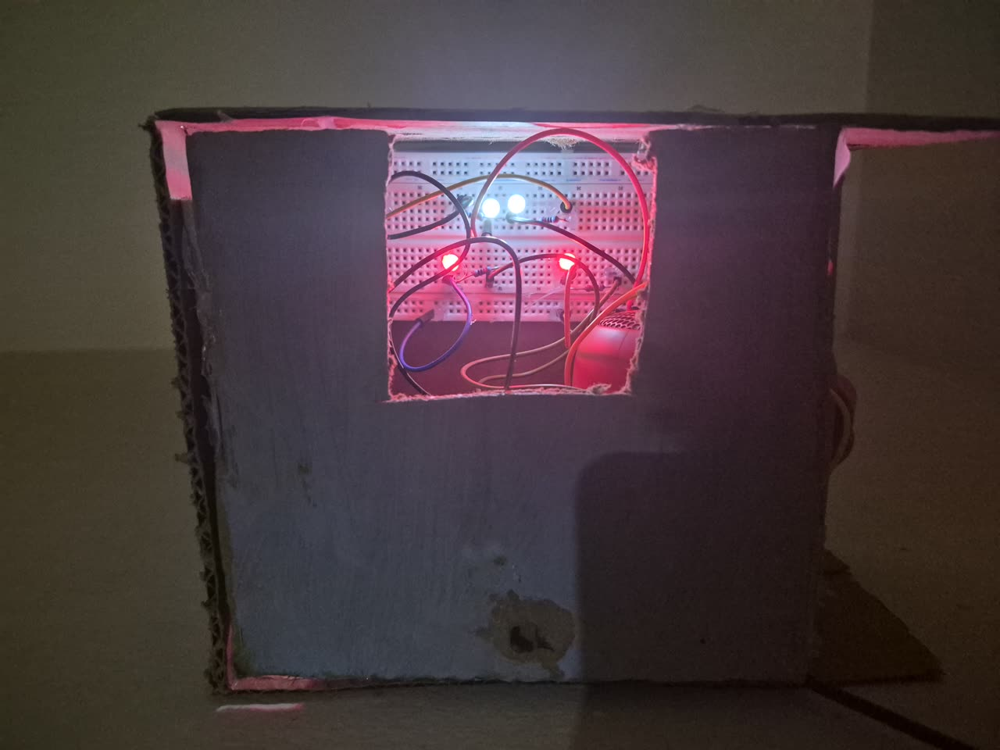
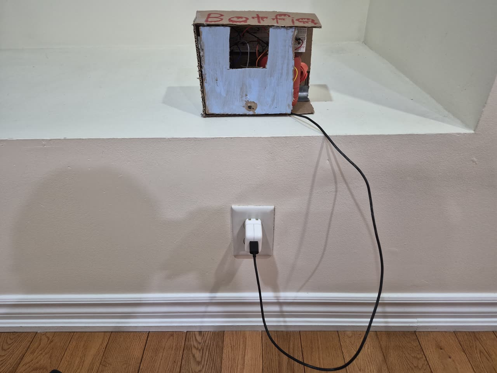
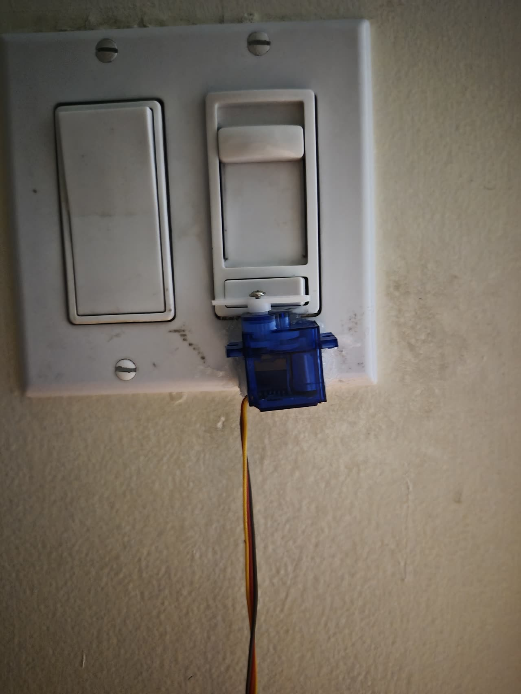
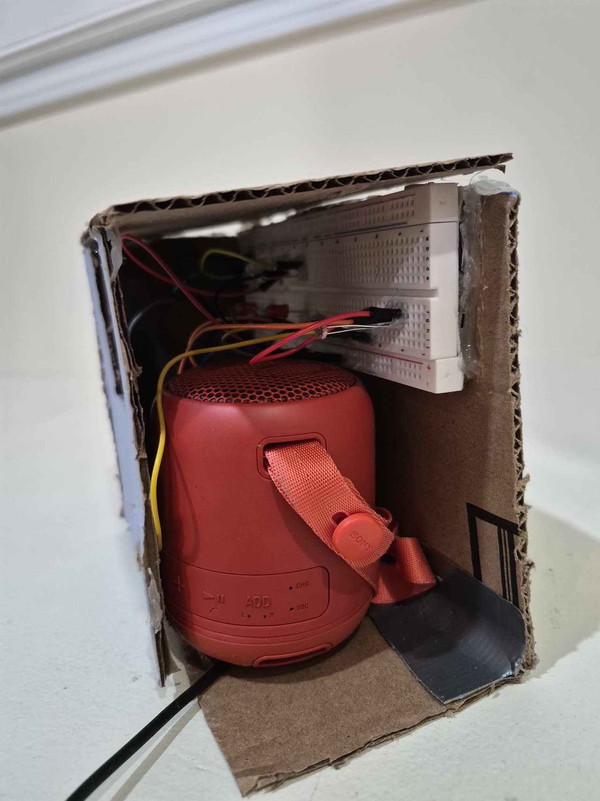
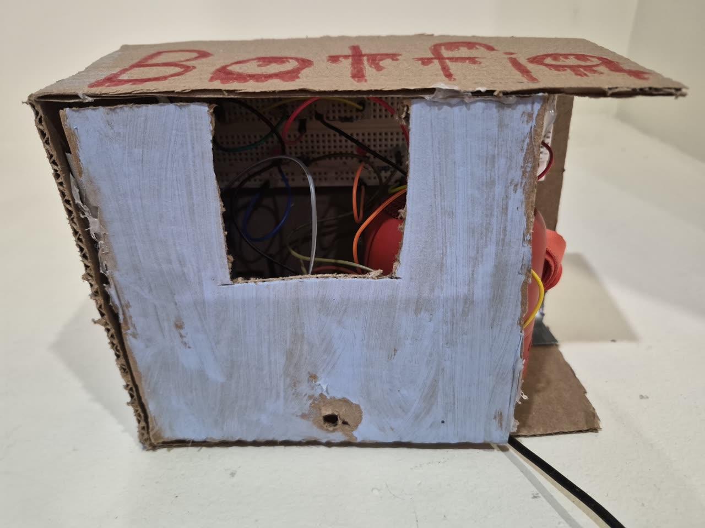
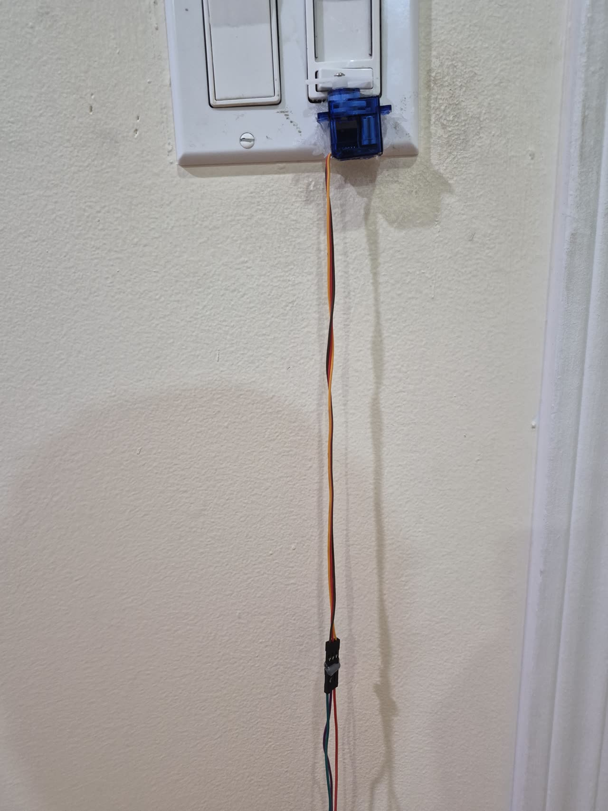
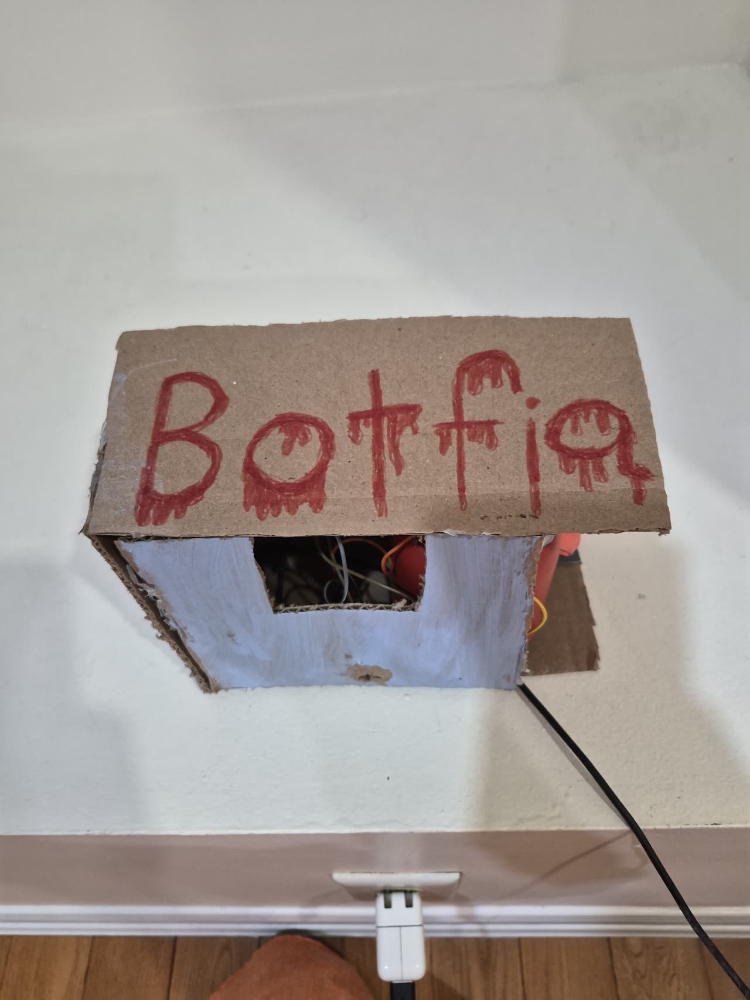

<h1 align="center">Botfia</h1>

<p align="center">
  <b>A robot that hosts the party game Mafia.</b><br>
  It turns off your room's lights, opens its glowing eyes, and narrates the whole night out loud, no phones, no cameras, no cards. Just one device passed around the circle.
</p>

<p align="center">
  
</p>

<p align="center">
  
  
  
  
  
  
</p>

---

## What it is

Botfia is a physical game master for **Mafia** (a.k.a. Werewolf). It sits on the table and runs the
whole game itself: it secretly deals the roles, walks the group through each night and day, **flips the
room's real light switch** with a servo, lights its **eyes and smile** when the room goes dark, plays
quiet music, and **tells the story of the game out loud** in a different scene every time.

It's **pass‑and‑play on one shared device**, everyone uses a single phone/tablet/laptop that gets
passed around. No personal phones, no cameras, no physical cards. A neutral hand‑off screen and a
minimum turn time mean you can't tell anyone's role from the shape or timing of their screen.

<table>
  <tr>
    <td width="50%"><br><sub align="center"><b>Botfia</b>, at the wall, a cardboard town that watches the room.</sub></td>
    <td width="50%"><br><sub><b>The light switch.</b> An SG90 servo flips the real rocker, lights out for night, back on at dawn.</sub></td>
  </tr>
</table>

## How a game plays

1. **Setup**, the host types in player names (in pass order) and picks options: voting style, discussion
   time, and whether to add the **Jester**. Names are saved, so a refresh never loses them.
2. **Roles**, the device goes around; each player **presses and holds** to see their secret role, and it
   hides the instant they let go. Mafia also see their teammates.
3. **Night**, Botfia flips the lights **off**; the ESP32's light sensor confirms the room is dark; the
   **eyes and smile glow** and quiet music fades in. The device passes around so each player takes a turn, every turn looks and lasts the same so roles stay hidden.
4. **Morning**, lights back on, eyes off, and Botfia narrates **by name** who didn't make it through the
   night (and reveals the role).
5. **Day**, a calm discussion countdown: argue, accuse, defend. Then vote (secret or open).
6. **End**, Town wins when the Mafia is gone; Mafia wins when it reaches parity; the **Jester** wins if
   the town votes it out. Every role is revealed.

## Features

- **Real‑world drama**, a servo physically switches your room lights; the ESP32 confirms darkness with a
  photoresistor before the eyes light up.
- **Storyteller narration**, Claude writes a fresh, atmospheric 2‑sentence scene for every beat (a lamplit
  town at the edge of the woods). It only ever knows public facts, **roles never leak**, proven by tests.
- **Local voice**, Piper text‑to‑speech on the Pi, pitched and paced for a calm, serious narrator.
- **Mood music**, instrumental tracks tagged calm / uneasy / tense / final, ducked under narration.
- **Premium PWA**, dark, minimal, installable, one‑handed, with a near‑black **night mode** so the screen
  only lights the person holding it.
- **Roles**, Mafia, Doctor, Detective, Villager, and an optional **Jester**. The Detective sees a
  red/green read (and a Jester reads red too, so a hit isn't proof).
- **Host controls**, pause, add time, repeat the last line, skip to vote, light test, music + volume,
  end, restart, all behind a deliberate long‑press.
- **Never breaks**, if the internet or Claude is down it falls back to a large prewritten scene bank; if
  the speaker or ESP32 is absent the game plays on.
- **Plug‑and‑play**, everything autostarts on boot via systemd; the speaker auto‑reconnects.

## The build

| Part | Role |
|------|------|
| **Raspberry Pi 5** | The brain, game engine, web server, Claude, TTS, music, and the light‑switch servo |
| **ESP32‑WROOM‑32** | On the table, drives the eye LEDs, smile LEDs, and the room‑dark photoresistor over Wi‑Fi |
| **SG90 servo** | Physically flips the wall light switch (hardware PWM, GPIO 18) |
| **Sony SRS‑XB12** | Bluetooth speaker for all narration and music |
| 2 red + 2 white LEDs, photoresistor, resistors, breadboard | The face and the light sensor |

The Pi mounts at the wall switch; the ESP32, LEDs, sensor, and speaker live in the enclosure on the table.
Full step‑by‑step wiring is in **[WIRING.md](WIRING.md)**.

<details>
<summary><b>More build photos</b></summary>
<br>
<table>
  <tr>
    <td width="50%"><br><sub>Inside: the breadboard circuit and the Sony speaker.</sub></td>
    <td width="50%"><br><sub>The face cutout where the eyes and smile show through.</sub></td>
  </tr>
  <tr>
    <td width="50%"><br><sub>The servo at the switch, wired back to the Pi.</sub></td>
    <td width="50%"><br><sub>Low‑tech shell, over‑engineered insides.</sub></td>
  </tr>
</table>
</details>

## How it fits together

```
 Shared device  ──Wi‑Fi──▶  Raspberry Pi 5  ──Bluetooth──▶  Sony speaker
 (phone/tablet)             ├─ game engine (plain code, decides everything)
                            ├─ Claude narration  +  Piper voice  +  music
                            ├─ SG90 servo ──▶ wall light switch (GPIO)
                            └──HTTP/JSON──▶  ESP32 (eyes, smile, light sensor)
```

The **game is plain code**, a state machine decides every outcome. Claude only writes the words and picks
a mood; it never decides anything and never sees a secret. Upcoming lines are pre‑generated during the
night so Botfia speaks instantly.

## Tech stack

Python · Flask · Anthropic Claude (Sonnet) · Piper TTS · ffmpeg · PipeWire · a vanilla‑JS installable PWA ·
PlatformIO / Arduino (ESP32) · systemd · Raspberry Pi hardware PWM.

## Run it

On the Pi, everything starts on boot via systemd, plug it in and it's ready. During development:

```bash
python -m pi.app          # serve the app on the Pi (open http://botfia.local on the same Wi‑Fi)
```

**No hardware?** A full simulation runs on a laptop, mocked light, mocked ESP32, audio on the laptop, so you can play an entire game while testing:

```bash
python -m pi.sim          # play a whole game with no hardware
```

## Guides

- **[WIRING.md](WIRING.md)**, wire the ESP32 table unit, step by step, for a first‑timer.
- **[docs/SETUP.md](docs/SETUP.md)**, one‑time setup: API key, Wi‑Fi, music, voice, light calibration.
- **[docs/SPEAKER.md](docs/SPEAKER.md)**, pair the Bluetooth speaker.
- **[docs/GAME_NIGHT.md](docs/GAME_NIGHT.md)**, everything to start a game, in order.
- **[CLAUDE.md](CLAUDE.md)**, the full spec: architecture, pin map, the Pi↔ESP32 HTTP contract, and the style rules.

## Credits

- Narration by **Anthropic Claude**; local voice by **[Piper](https://github.com/rhasspy/piper)**.
- Music by **Kevin MacLeod** ([incompetech.com](https://incompetech.com)), licensed CC BY 4.0, see
  [`music/CREDITS.txt`](music/CREDITS.txt).
